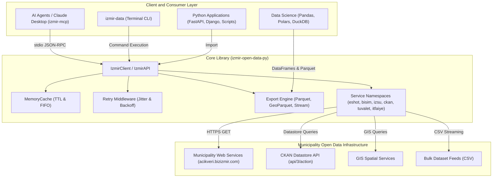

<!-- /* well-document · audit scorecard: G1:5 G2:5 G3:5 G4:5 G5:5 G6:5 · STATUS: PASS */ -->
<p align="center">
  
</p>

# izmir-open-data-py

Modern, asynchronous Python client library, terminal CLI utility, and Model Context Protocol (FastMCP) server for the Izmir Metropolitan Municipality Open Data Portal API services.

[](LICENSE)
[](https://python.org)
[](https://pydantic.dev)
[](https://atacanymc.github.io/izmir-open-data-py/)
[](https://github.com/astral-sh/ruff)
[](https://modelcontextprotocol.io/)

[Türkçe](README.md) | [English](README.en.md) | [Live Documentation Portal](https://atacanymc.github.io/izmir-open-data-py/)

---

## Table of Contents

- [System Architecture](#system-architecture)
- [Installation](#installation)
- [Quick Start](#quick-start)
  - [1. Programmatic Library Usage](#1-programmatic-library-usage)
  - [2. Terminal CLI Utility](#2-terminal-cli-utility)
  - [3. Model Context Protocol (MCP) Server](#3-model-context-protocol-mcp-server)
  - [4. Advanced Features (Cache, Retry, CKAN Query Builder, GeoJSON)](#4-advanced-features-cache-retry-ckan-query-builder-geojson)
  - [5. Data Science Integrations (Pandas, Polars, Parquet, Streams)](#5-data-science-integrations-pandas-polars-parquet-streams)
  - [6. Offline Testing Infrastructure (Mock Client)](#6-offline-testing-infrastructure-mock-client)
- [Endpoint Namespaces](#endpoint-namespaces)
- [Development and Testing](#development-and-testing)
- [License](#license)

---

## System Architecture

The library provides a unified asynchronous client layer for applications, terminal users, and AI agents. The underlying engine uses `httpx` for REST endpoints, CKAN Datastore queries, and GIS web services.



---

## Installation

Install the package directly into your virtual environment:

```bash
git clone https://github.com/AtaCanYmc/izmir-open-data-py.git
cd izmir-open-data-py

# Standard installation
uv pip install -e .

# With data science extras (pandas, polars, pyarrow)
uv pip install -e ".[data]"

# For development and test tooling
uv pip install -e ".[dev]"
```

---

## Quick Start

### 1. Programmatic Library Usage

The library includes static typing and Pydantic V2 validation. Access all namespaces via `IzmirClient` (or `IzmirAPI`):

```python
import asyncio
from izmir_open_data import IzmirClient


async def main():
    async with IzmirClient() as client:
        # Query on-duty pharmacies
        pharmacies = await client.eczaneler.get_nobetci_list()
        print(f"On-duty pharmacies count: {len(pharmacies)}")

        # ESHOT bus lines list
        lines = await client.eshot.get_hatlar()
        print(f"Total bus lines: {len(lines)}")

        # BISIM smart bike station occupancy
        bisim = await client.bisim.get_istasyon_list()
        for st in bisim.kayitlar[:3]:
            print(f"Station: {st.adi} | Available bikes: {st.bos_bisiklet_sayisi}")


if __name__ == "__main__":
    asyncio.run(main())
```

### 2. Terminal CLI Utility

Use the `izmir-data` command to inspect datasets directly from the terminal:

```bash
# Display help and available commands
izmir-data --help

# Search across 260+ datasets on acikveri.bizizmir.com
izmir-data search tuvalet --limit 5

# Query records from any CKAN datastore resource
izmir-data datastore d87de3c1-9bc0-4a8c-842a-90cd2a30d03a --limit 5

# Display GIS dataset in formatted terminal table
izmir-data get cbs/afetaciltoplanmaalani
izmir-data get cbs/plajlar
```

For detailed CLI usage, see [docs/CLI.md](docs/CLI.md).

### 3. Model Context Protocol (MCP) Server

`izmir-open-data-py` includes a FastMCP server (`izmir-mcp`) allowing tools like Claude Desktop or Cursor to query municipal data directly.

Add to `claude_desktop_config.json`:

```json
{
  "mcpServers": {
    "izmir-open-data": {
      "command": "izmir-mcp"
    }
  }
}
```

For tool schemas and discovery mechanisms, see [docs/MCP.md](docs/MCP.md).

### 4. Advanced Features (Cache, Retry, CKAN Query Builder, GeoJSON)

#### In-Memory TTL Cache

Prevent redundant network calls using a configurable TTL cache with FIFO eviction:

```python
from izmir_open_data import IzmirClient, MemoryCache

# Enable default 5-minute cache
client = IzmirClient(cache=True)

# Or configure custom TTL (in ms) and capacity:
client = IzmirClient(cache=MemoryCache(default_ttl_ms=60_000, max_items=200))

# First call fetches from network, second returns from memory
data1 = await client.eczaneler.get_nobetci_list()
data2 = await client.eczaneler.get_nobetci_list()

# Clear cache manually
await client.clear_cache()
```

#### Request Retry Middleware with Jitter

Exponential backoff with full jitter for transient 5xx, 429, and network disconnects:

```python
from izmir_open_data import IzmirClient, RetryConfig

client = IzmirClient(
    retry=RetryConfig(
        retries=3,
        base_delay_ms=300,
        max_delay_ms=3000,
        jitter=True,
    )
)
```

#### CKAN Fluent Query Builder

Chain filters, full-text search, sorting, and pagination across CKAN datastore resources:

```python
query = (
    client.ckan.query("d87de3c1-9bc0-4a8c-842a-90cd2a30d03a")
    .where("ILCE", "KONAK")
    .search("Alsancak")
    .sort("TARIH", "desc")
    .page(1, 20)
)

# Fetch single page
result = await query.execute()
print(result["records"])

# Automatically paginate and retrieve all matching records
all_records = await query.fetch_all(batch_size=100, max_records=500)
```

#### GeoJSON Geometry Normalizer

Convert various municipal coordinate formats (GIS `BOYLAM`/`ENLEM`, Software Division `LokasyonX`/`LokasyonY`) into RFC 7946 GeoJSON:

```python
from izmir_open_data import to_geojson, extract_coordinates

# Extract single point coordinates as [longitude, latitude]
coords = extract_coordinates({"LokasyonX": "38.4192", "LokasyonY": "27.1287"})
# (27.1287, 38.4192)

# Convert list or OnemliYerWrapper to standard GeoJSON FeatureCollection
parks = await client.cografi.get_meydanlar_list()
geojson_data = to_geojson(parks)

print(geojson_data["type"])  # "FeatureCollection"
print(geojson_data["features"][0]["geometry"]["coordinates"])
```

### 5. Data Science Integrations (Pandas, Polars, Parquet, Streams)

Direct export tools for analytical notebooks and machine learning pipelines:

```python
from izmir_open_data import to_dataframe, to_polars, to_parquet, to_geoparquet

# 1. Convert to Pandas or Polars DataFrames
df = await client.ckan.query("res-id").where("ILCE", "KONAK").to_dataframe()
pldf = await client.ckan.query("res-id").where("ILCE", "KONAK").to_polars()

# 2. Asynchronous generator streams (memory-efficient paging)
async for item in client.ckan.query("res-id").stream(batch_size=200):
    process(item)

# 3. Store locally in compressed Parquet or GeoParquet (WKB Point) format
await client.ckan.query("res-id").to_parquet("records.parquet")
await client.ckan.query("res-id").to_geoparquet("spatial.geoparquet")
```

### 6. Offline Testing Infrastructure (Mock Client)

Run test suites without internet access or in air-gapped CI environments:

```python
from izmir_open_data import MockIzmirClient, get_fixture

# Access realistic pre-recorded fixtures
eczaneler = get_fixture("eczaneler")

# Mock client that performs no network calls
client = MockIzmirClient()
nobetci = await client.eczaneler.get_list()
assert len(nobetci) > 0
```

---

## Endpoint Namespaces

| Category | Namespaces | Scope and Primary Methods |
| --- | --- | --- |
| **Public Transit** | `client.eshot`, `client.metro`, `client.tramvay`, `client.izban`, `client.vapur` | Bus lines, stops, departure schedules, routes, and live vehicle positions. |
| **Micromobility** | `client.bisim`, `client.taksi` | BISIM smart bike stations, bike occupancy, and taxi stands. |
| **Healthcare & Pharmacy** | `client.eczaneler`, `client.saglik` | On-duty pharmacies, all pharmacies, hospitals, and emergency stations. |
| **Water & Infrastructure** | `client.izsu`, `client.otopark`, `client.afetler` | Dam water levels, water production, parking occupancy, and disaster gathering areas. |
| **Urban Sanitation & Safety** | `client.tuvalet`, `client.turuncucember`, `client.itfaiye`, `client.izum`, `client.trafik` | Smart public toilets, Orange Circle certified venues, fire emergency incidents, and arterial speed data. |
| **Culture & Community** | `client.kutuphane`, `client.etkinlikler`, `client.egitim` | Libraries, museums, cinemas, schools, and city events calendar. |
| **Civic Services & Geography** | `client.kamu`, `client.cografi`, `client.muhtarliklar` | Public offices, notary public, post offices, lakes, mountains, and coastline data. |
| **Open Data CKAN** | `client.ckan`, `client.get_ckan()`, `client.get_ckan_dump()` | Search across 260+ datasets, datastore queries, and bulk JSON dumps. |

For detailed method references, consult [docs/ENDPOINTS.md](docs/ENDPOINTS.md) and [docs/CLIENT.md](docs/CLIENT.md).

---

## Development and Testing

Run test suites, linting, and type checking:

```bash
# Install development dependencies
uv pip install -e ".[dev]"

# Run unit tests
uv run pytest

# Check code style and formatting
uv run ruff check .

# Static type analysis
uv run mypy src

# Run live endpoint tests (requires network connectivity)
LIVE_API_TESTS=1 uv run pytest tests/test_live_endpoints.py
```

---

## License

This project is licensed under the [Apache 2.0 License](LICENSE). Copyright (c) 2026 Ata Can Yaymacı.
