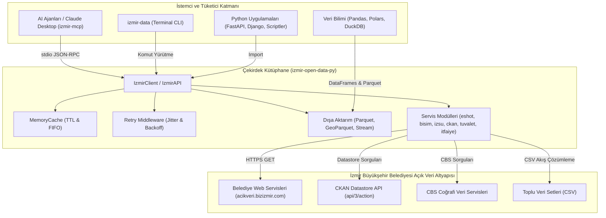

<!-- /* well-document · audit scorecard: G1:5 G2:5 G3:5 G4:5 G5:5 G6:5 · STATUS: PASS */ -->
<p align="center">
  
</p>

# izmir-open-data-py

İzmir Büyükşehir Belediyesi Açık Veri Portalı API servisleri için geliştirilmiş modern, asenkron Python istemci kütüphanesi, terminal CLI aracı ve Model Context Protocol (FastMCP) sunucusu.

[](LICENSE)
[](https://python.org)
[](https://pydantic.dev)
[](https://atacanymc.github.io/izmir-open-data-py/)
[](https://github.com/astral-sh/ruff)
[](https://modelcontextprotocol.io/)

[Türkçe](README.md) | [English](README.en.md) | [Canlı Web Portalı & Dokümantasyon](https://atacanymc.github.io/izmir-open-data-py/)

---

## İçindekiler

- [Sistem Mimarisi](#sistem-mimarisi)
- [Kurulum](#kurulum)
- [Hızlı Başlangıç](#hızlı-başlangıç)
  - [1. Programatik Kütüphane Kullanımı](#1-programatik-kütüphane-kullanımı)
  - [2. Terminal CLI Aracı](#2-terminal-cli-aracı)
  - [3. Model Context Protocol (MCP) Sunucusu](#3-model-context-protocol-mcp-sunucusu)
  - [4. Gelişmiş Özellikler (Önbellek, Retry, CKAN Query Builder, GeoJSON)](#4-gelişmiş-özellikler-önbellek-retry-ckan-query-builder-geojson)
  - [5. Veri Bilimi Entegrasyonları (Pandas, Polars, Parquet, Streams)](#5-veri-bilimi-entegrasyonları-pandas-polars-parquet-streams)
  - [6. Çevrimdışı Test Altyapısı (Mock Client)](#6-çevrimdışı-test-altyapısı-mock-client)
- [Uç Nokta ve Servis Modülleri](#uç-nokta-ve-servis-modülleri)
- [Geliştirme ve Test](#geliştirme-ve-test)
- [Lisans](#lisans)

---

## Sistem Mimarisi

Kütüphane; uygulama kodları, komut satırı kullanıcıları ve yapay zeka ajanları için ortak bir asenkron istemci katmanı sunar. `httpx` tabanlı HTTP motoru REST servislerine, CKAN Datastore API'sine ve CBS veri kaynaklarına bağlanır.



---

## Kurulum

Projeyi doğrudan klonlayıp ortamınıza kurabilirsiniz:

```bash
git clone https://github.com/AtaCanYmc/izmir-open-data-py.git
cd izmir-open-data-py

# Standart kurulum
uv pip install -e .

# Veri bilimi kütüphaneleri (pandas, polars, pyarrow) ile kurulum
uv pip install -e ".[data]"

# Geliştirme ve test araçlarıyla kurulum
uv pip install -e ".[dev]"
```

---

## Hızlı Başlangıç

### 1. Programatik Kütüphane Kullanımı

Kütüphane tam tip tanımlamaları ve Pydantic V2 desteği içerir. `IzmirClient` (veya `IzmirAPI`) üzerinden ilgili servis ad alanlarına erişebilirsiniz:

```python
import asyncio
from izmir_open_data import IzmirClient


async def main():
    async with IzmirClient() as client:
        # Nöbetçi eczaneleri sorgulama
        eczaneler = await client.eczaneler.get_nobetci_list()
        print(f"Nöbetçi eczane sayısı: {len(eczaneler)}")

        # ESHOT hat listesi
        hatlar = await client.eshot.get_hatlar()
        print(f"Toplam hat sayısı: {len(hatlar)}")

        # BİSİM istasyon doluluk oranları
        bisim = await client.bisim.get_istasyon_list()
        for ist in bisim.kayitlar[:3]:
            print(f"İstasyon: {ist.adi} | Boş Bisiklet: {ist.bos_bisiklet_sayisi}")


if __name__ == "__main__":
    asyncio.run(main())
```

### 2. Terminal CLI Aracı

`izmir-data` komutu ile belediye veri setlerini doğrudan terminalde tablo formatında görüntüleyebilirsiniz:

```bash
# Yardım menüsü
izmir-data --help

# Portalda veri seti arama (260+ veri seti)
izmir-data search tuvalet --limit 5

# Belirli bir CKAN datastore kaynağından veri çekme
izmir-data datastore d87de3c1-9bc0-4a8c-842a-90cd2a30d03a --limit 5

# CBS veri setini tablo olarak görüntüleme
izmir-data get cbs/afetaciltoplanmaalani
izmir-data get cbs/plajlar
```

Ayrıntılı komut açıklamaları için [docs/CLI.md](docs/CLI.md) sayfasına başvurabilirsiniz.

### 3. Model Context Protocol (MCP) Sunucusu

`izmir-open-data-py`, Claude Desktop veya Cursor gibi yapay zeka araçlarına belediye verilerini sunan standart bir FastMCP sunucusu (`izmir-mcp`) barındırır.

`claude_desktop_config.json` dosyasına ekleyin:

```json
{
  "mcpServers": {
    "izmir-open-data": {
      "command": "izmir-mcp"
    }
  }
}
```

Ayrıntılı araç ve entegrasyon açıklamaları için [docs/MCP.md](docs/MCP.md) sayfasına başvurabilirsiniz.

### 4. Gelişmiş Özellikler (Önbellek, Retry, CKAN Query Builder, GeoJSON)

#### In-Memory TTL Önbellek (Cache)

Belediye sunucularına mükerrer istek gönderilmesini engellemek için TTL ve FIFO tabanlı dahili bellek önbelleği:

```python
from izmir_open_data import IzmirClient, MemoryCache

# 5 dakika varsayılan TTL ile önbelleği aktifleştirme
client = IzmirClient(cache=True)

# Özel TTL (milisaniye) ve azami kayıt adedi ile:
client = IzmirClient(cache=MemoryCache(default_ttl_ms=60_000, max_items=200))

# İlk çağrı ağdan çeker, ikincisi bellekten anında döner
data1 = await client.eczaneler.get_nobetci_list()
data2 = await client.eczaneler.get_nobetci_list()

# Önbelleği temizleme
await client.clear_cache()
```

#### İstek Yeniden Deneme (Retry Middleware)

Geçici 5xx sunucu hataları ve ağ kesintilerinde rastgele sapmalı (jitter) üstel geri çekilme:

```python
from izmir_open_data import IzmirClient, RetryConfig

client = IzmirClient(
    retry=RetryConfig(
        retries=3,  # Azami 3 deneme
        base_delay_ms=300,  # Başlangıç beklemesi (ms)
        max_delay_ms=3000,  # Tavan bekleme (ms)
        jitter=True,  # Yük yığılmasını önleyen rastgele sapma
    )
)
```

#### CKAN Akıcı Sorgu Oluşturucu (Query Builder)

CKAN Datastore üzerinde zincirleme filtreleme, metin araması, sıralama ve otomatik sayfalama:

```python
query = (
    client.ckan.query("d87de3c1-9bc0-4a8c-842a-90cd2a30d03a")
    .where("ILCE", "KONAK")
    .search("Alsancak")
    .sort("TARIH", "desc")
    .page(1, 20)
)

# İlk sayfayı çekme
result = await query.execute()
print(result["records"])

# Otomatik sayfalamayla tüm kayıtları çekme
all_records = await query.fetch_all(batch_size=100, max_records=500)
```

#### GeoJSON Geometri Dönüştürücüsü (GeoJSON Normalizer)

Farklı belediye veri formatlarını (CBS `BOYLAM`/`ENLEM`, Yazılım Şube `LokasyonX`/`LokasyonY`) standart RFC 7946 GeoJSON formatına dönüştürme:

```python
from izmir_open_data import to_geojson, extract_coordinates

# Tekil nokta koordinatını (boylam, enlem) olarak alma
coords = extract_coordinates({"LokasyonX": "38.4192", "LokasyonY": "27.1287"})
# (27.1287, 38.4192)

# CBS veya POI listesini standart GeoJSON FeatureCollection formatına dönüştürme
parklar = await client.cografi.get_meydanlar_list()
geojson_data = to_geojson(parklar)

print(geojson_data["type"])  # "FeatureCollection"
print(geojson_data["features"][0]["geometry"]["coordinates"])
```

### 5. Veri Bilimi Entegrasyonları (Pandas, Polars, Parquet, Streams)

Veri analitiği ve makine öğrenimi boru hatları için doğrudan dışa aktarım araçları:

```python
from izmir_open_data import to_dataframe, to_polars, to_parquet, to_geoparquet

# 1. Pandas veya Polars DataFrame'e dönüştürme
df = await client.ckan.query("res-id").where("ILCE", "KONAK").to_dataframe()
pldf = await client.ckan.query("res-id").where("ILCE", "KONAK").to_polars()

# 2. Asenkron jeneratör akışları (bellek dostu)
async for item in client.ckan.query("res-id").stream(batch_size=200):
    process(item)

# 3. Sıkıştırılmış Parquet veya GeoParquet (WKB Point) olarak kaydetme
await client.ckan.query("res-id").to_parquet("veriler.parquet")
await client.ckan.query("res-id").to_geoparquet("mekansal_veriler.geoparquet")
```

### 6. Çevrimdışı Test Altyapısı (Mock Client)

Ağ bağlantısı gerektirmeyen birim testleri koşturmak veya air-gapped ortamlarda çalışmak için dahili sahte veri seti altyapısı:

```python
from izmir_open_data import MockIzmirClient, get_fixture

# Hazır test verilerine erişim
eczaneler = get_fixture("eczaneler")

# Mock istemci ile ağ isteği atmadan geliştirme yapma
client = MockIzmirClient()
nobetci = await client.eczaneler.get_list()
assert len(nobetci) > 0
```

---

## Uç Nokta ve Servis Modülleri

Kütüphane, İzmir Açık Veri Portalı üzerindeki servisleri modüler ad alanlarına ayırır:

| Modül | Ad Alanı | Kapsam ve Temel Metotlar |
| --- | --- | --- |
| **Toplu Ulaşım** | `client.eshot`, `client.metro`, `client.tramvay`, `client.izban`, `client.vapur` | Hatlar, duraklar, hareket saatleri, güzergahlar ve canlı otobüs konumları. |
| **Mikro Hareketlilik** | `client.bisim`, `client.taksi` | BİSİM akıllı bisiklet istasyonları, bisiklet dolulukları ve taksi durakları. |
| **Sağlık & Eczane** | `client.eczaneler`, `client.saglik` | Nöbetçi eczaneler, tüm eczaneler, hastaneler ve acil yardım istasyonları. |
| **Su & Altyapı** | `client.izsu`, `client.otopark`, `client.afetler` | Baraj doluluk oranları, su üretimi, otopark dolulukları ve toplanma alanları. |
| **Kent & Hijyen** | `client.tuvalet`, `client.turuncucember`, `client.itfaiye`, `client.izum`, `client.trafik` | Akıllı tuvaletler, Turuncu Çember işletmeleri, itfaiye olay istatistikleri, İZUM hız ve araç sayımları. |
| **Kültür & Sosyal** | `client.kutuphane`, `client.etkinlikler`, `client.egitim` | Kütüphaneler, müzeler, sinemalar, okullar ve etkinlik takvimi. |
| **Kamu & Coğrafya** | `client.kamu`, `client.cografi`, `client.muhtarliklar` | Noterler, muhtarlıklar, PTT, göller, dağlar ve kıyı şeridi bilgileri. |
| **Açık Veri CKAN** | `client.ckan`, `client.get_ckan()`, `client.get_ckan_dump()` | 260+ veri setinde arama, filtreleme, datastore sorguları ve dump indirme. |

Tüm uç noktaların ayrıntılı listesi için [docs/ENDPOINTS.md](docs/ENDPOINTS.md), istemci yapılandırması için [docs/CLIENT.md](docs/CLIENT.md) sayfalarına bakabilirsiniz.

---

## Geliştirme ve Test

Tüm testleri ve kod standartlarını çalıştırmak için:

```bash
# Bağımlılıkları kurma
uv pip install -e ".[dev]"

# Birim testlerini çalıştırma
uv run pytest

# Kod kalitesi ve biçimlendirme denetimi
uv run ruff check .

# Tip denetimi
uv run mypy src

# Canlı API entegrasyon testlerini çalıştırma (ağ erişimi gerektirir)
LIVE_API_TESTS=1 uv run pytest tests/test_live_endpoints.py
```

---

## Lisans

Bu proje [Apache 2.0 Lisansı](LICENSE) kapsamında lisanslanmıştır. Telif hakkı (c) 2026 Ata Can Yaymacı.
